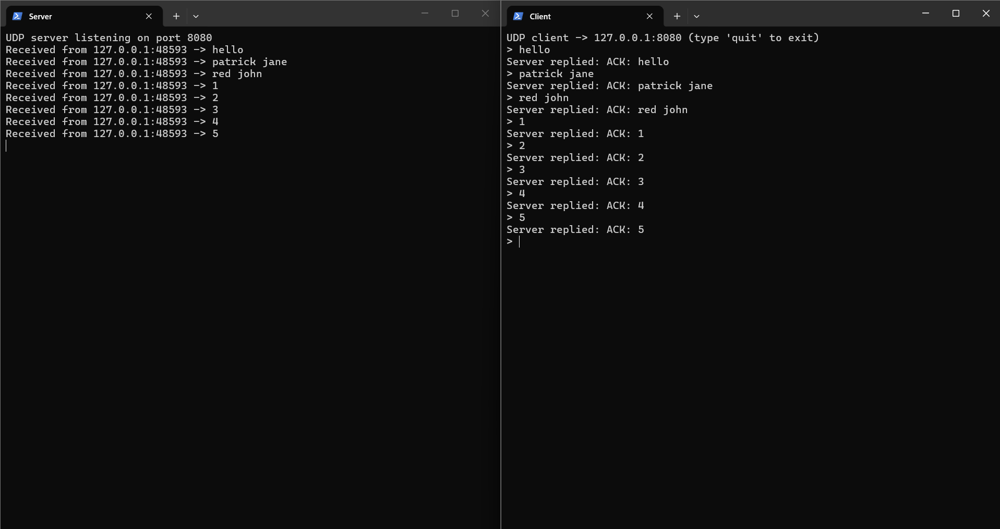

<!-- README.md -->

# udp-sockets

A minimal multi-client UDP client and server in C, built on POSIX (Berkeley) sockets.



## Overview

- **Server:** listens on a UDP port and serves many clients at the same time. It prints each datagram it receives along with the sender's address, keeps a table of the clients it has heard from, and replies with `ACK: <message>`.
- **Client:** reads lines from the keyboard, sends each one to the server, and prints the reply. If no reply arrives within 3 seconds, it reports a timeout. Start as many clients as you want, on one machine or on several.

UDP is connectionless. There is no `listen()`, `accept()` or `connect()`, and each datagram is independent and may be lost, duplicated or reordered.

### How the server handles many clients

With UDP there is no connection per client, so one socket and one loop serve everybody: `recvfrom()` returns the datagram together with the sender's address, and the server answers that address with `sendto()`. Clients never wait for each other, because each request is one datagram and one reply.

To make clients visible, the server keeps a table of up to 64 senders (IP address and port) with the number of messages each one sent. A new sender is announced with `New client`. A sender that stays silent for 60 seconds is forgotten (`Client timed out`), since UDP gives no notice when a client leaves. If the table is full, new senders are still answered, but they are not tracked.

## Requirements

- Linux, macOS, or Windows with WSL
- `gcc` and `make`
- Optional, for testing: `netcat` and Wireshark

On Debian/Ubuntu:

```bash
sudo apt update && sudo apt install -y gcc make netcat-openbsd
```

## Build

```bash
git clone https://github.com/ihcnabd/udp-sockets.git
cd udp-sockets
make
```

This produces the `server` and `client` binaries. Run `make clean` to remove them.

## Usage

### Server

```bash
./server [port]
```

| Argument | Default | Description                     |
| -------- | ------- | ------------------------------- |
| `port`   | `8080`  | UDP port to listen on (1-65535) |

The server binds to all network interfaces and runs until you stop it with `Ctrl+C`.

### Client

```bash
./client [server_ip] [port]
```

| Argument    | Default     | Description                                                               |
| ----------- | ----------- | ------------------------------------------------------------------------- |
| `server_ip` | `127.0.0.1` | IPv4 address of the server (dotted notation, hostnames are not supported) |
| `port`      | `8080`      | Server UDP port                                                           |

Type a message and press Enter to send it. Type `quit` (or press `Ctrl+D`) to exit. Empty lines are ignored.

### Example with two clients

Terminal 1 (server):

```
$ ./server 8080
UDP server listening on port 8080 (tracks up to 64 clients)
New client: 127.0.0.1:53124 (1 active)
Received from 127.0.0.1:53124 (message 1) -> hello
New client: 127.0.0.1:41872 (2 active)
Received from 127.0.0.1:41872 (message 1) -> hi from client 2
Received from 127.0.0.1:53124 (message 2) -> how are you
Client timed out: 127.0.0.1:53124 (1 active)
Client timed out: 127.0.0.1:41872 (0 active)
```

Terminal 2 (first client):

```
$ ./client 127.0.0.1 8080
UDP client -> 127.0.0.1:8080 (type 'quit' to exit)
> hello
Server replied: ACK: hello
> how are you
Server replied: ACK: how are you
> quit
```

Terminal 3 (second client, started while the first is still running):

```
$ ./client 127.0.0.1 8080
UDP client -> 127.0.0.1:8080 (type 'quit' to exit)
> hi from client 2
Server replied: ACK: hi from client 2
> quit
```

The two `Client timed out` lines appear about 60 seconds after each client's last message.

### Running on two machines

1. On the server machine, find its IP address (`ip addr`) and start `./server 8080`.
2. Allow UDP port 8080 through the firewall.
3. On each other machine, run `./client <server_ip> 8080`. Any number of machines can send at the same time.

## Testing without the client

Send a datagram with netcat:

```bash
echo -n "hello" | nc -u -w1 127.0.0.1 8080
```

Expected reply: `ACK: hello`

### Testing many clients at once

Start the server, then send five messages from five parallel senders:

```bash
for i in 1 2 3 4 5; do echo -n "hello from $i" | nc -u -w1 127.0.0.1 8080 & done; wait
```

Expected: five `ACK: hello from N` replies (in any order), and in the server window five `New client` lines, each from a different port, with the active count going up to 5.

## Inspecting the traffic

To see the datagrams on the wire, capture the loopback interface in Wireshark with the display filter:

```
udp.port == 8080
```

Each message appears as one UDP packet, and the `ACK: ...` reply as another in the opposite direction. With several clients, each one uses its own source port, so you can tell them apart. The payload is plain text.

## Protocol

| Property         | Value                                                                     |
| ---------------- | ------------------------------------------------------------------------- |
| Transport        | UDP over IPv4                                                             |
| Request          | One datagram containing the message text                                  |
| Reply            | One datagram containing `ACK: <message>`                                  |
| Max message size | 1023 bytes (longer messages are truncated)                                |
| Client timeout   | 3 seconds                                                                 |
| Clients          | Many at the same time (tracked up to 64, forgotten after 60 s of silence) |

## Project structure

```
udp-sockets/
├── src/
│   ├── server.c
│   └── client.c
├── docs/
│   └── demo.png
├── Makefile
├── LICENSE
└── README.md
```

## Troubleshooting

| Problem                                    | Cause and fix                                                                                                              |
| ------------------------------------------ | -------------------------------------------------------------------------------------------------------------------------- |
| `bind: Address already in use`             | Another process uses the port. Pick another port or stop the other process.                                                |
| `bind: Permission denied`                  | Ports below 1024 need root. Use a port of 1024 or higher.                                                                  |
| `No reply from server (timeout after 3 s)` | The server is not running, the IP or port is wrong, or a firewall blocks UDP. UDP gives no error when nobody is listening. |
| `Invalid IP address`                       | The client accepts only IPv4 addresses such as `192.168.1.10`, not hostnames.                                              |
| `nc: command not found`                    | Install netcat, or on Windows run the command inside WSL.                                                                  |

## Limitations

This is a simple educational implementation. Plain UDP as used here has:

- **No authentication:** the server answers any sender, and a sender's address can be faked.
- **No encryption:** messages are sent in clear text.
- **No reliability:** lost datagrams are not retransmitted, and the client does not retry.
- **One loop for all clients:** datagrams are handled one after another. This is fine because each exchange is tiny, but a slow handler would delay every client.
- **Tracking table of 64 clients:** extra senders are still answered but not counted.
- **IPv4 only.**

## License

MIT, see [LICENSE](LICENSE).

## Author

Houcine Abdaoui, [github.com/ihcnabd](https://github.com/ihcnabd)
